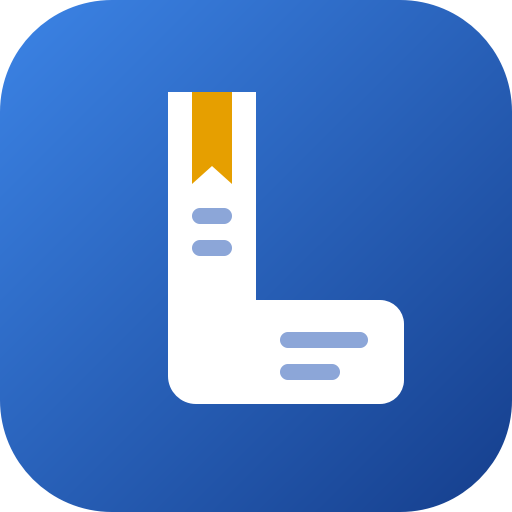
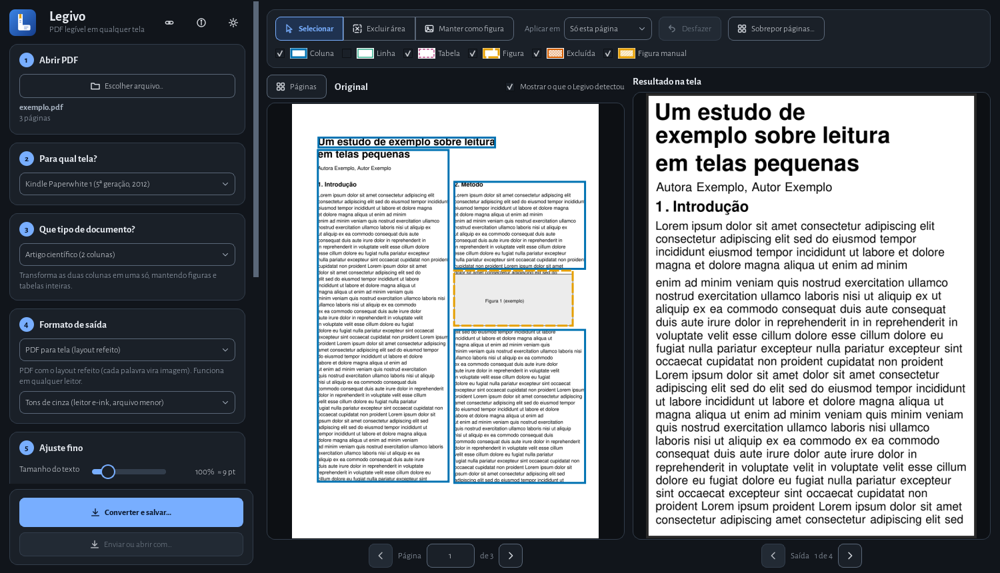

<p align="center"></p>

# Legivo

**PDF legível em qualquer tela.** O Legivo pega artigos científicos, provas e livros de RPG de várias colunas e refaz o layout para ficarem confortáveis de ler no Kindle, no Kobo, no KOReader, no tablet ou numa tela grande com a letra ampliada. Tudo com **pré-visualização na hora**, sem precisar decifrar dezenas de parâmetros.

<p align="center">
  
</p>

> *Legivo* vem de "legível" / "legible". Criado por **Igor Teuri**, inspirado no [K2pdfopt](https://www.willus.com/k2pdfopt/) (Willus.com, GPLv3).

## Para quem é

- **Artigos científicos** com 2 colunas, equações, figuras e notas de rodapé, para ler no e-reader.
- **Livros de RPG de mesa** com várias colunas, caixas laterais, tabelas e fundos decorados.
- **Baixa visão e acessibilidade**: provas e documentos de 2 colunas ampliados, com fonte grande e alto contraste.

## O que faz

- **Reorganiza o layout**: detecta colunas, títulos, figuras e tabelas e refaz as linhas para a largura da tela escolhida (A4, Kindle, Kobo...), mantendo o equilíbrio entre títulos, texto e figuras.
- **Pré-visualização ao vivo** do original (com as regiões detectadas) e do resultado, com miniaturas de todas as páginas e o mapa "página de origem → páginas de saída".
- **Edição manual**: excluir cabeçalhos e números de página (com sugestão automática), manter uma região como figura, mover e redimensionar as marcações. O programa também pergunta quando tem dúvida (é tabela? é imagem?) e aplica a resposta às páginas parecidas.
- **Formulários e provas**: bolinhas das alternativas, faixas de cabeçalho e campos de preencher (Nome, Matrícula...) são preservados.
- **EPUB de verdade**: reorganiza o *texto* (sem transformá-lo em imagens), com títulos, negrito/itálico, índice e figuras. O aparelho escolhe o tamanho da letra.
- **Tabelas de verdade no EPUB**: detecta tabelas e as recria com células, linhas e colunas (também em PDFs escaneados, usando o OCR).
- **OCR offline** para PDFs só de imagem (escaneados), com acentos em português e inglês.
- **Conexões**: biblioteca do Calibre (adicionar, converter para AZW3/MOBI), KOReader por Wi-Fi (catálogo OPDS) e Kindle/Kobo/KOReader por USB.
- Perfis para artigo, prova, RPG e baixa visão; tema claro/escuro; cores seguras para daltonismo; tamanhos de fonte em pontos.
- **Portátil e privado**: não instala nada, não usa o registro do Windows e processa tudo no seu computador, sem internet.

## Baixar e usar (Windows)

Página do projeto: **[igorteuri.github.io/legivo](https://igorteuri.github.io/legivo/)**. Os arquivos ficam em [Releases](https://github.com/igorteuri/legivo/releases):

| Arquivo | Para quê |
|---|---|
| `Legivo-Setup-x.y.z.exe` | **Instalador** (só para o seu usuário, sem administrador, com atalho no menu Iniciar). Versão completa, com OCR. |
| `Legivo-x.y.z-portatil.zip` | Pasta **portátil** completa: extraia onde quiser (até num pen drive) e abra `Legivo.exe`. |
| `Legivo-Setup-x.y.z-lite.exe` / `Legivo-x.y.z-lite-portatil.zip` | Versão **lite**: sem OCR para PDFs escaneados e bem menor (instalador de ~48 MB). |

- O programa leva dentro o Python, o Qt e (na versão completa) o OCR, por isso é uma pasta e não um arquivo único: um `.exe` único teria o mesmo tamanho e demoraria vários segundos para abrir toda vez.
- O Windows pode mostrar o aviso "O Windows protegeu o computador" (SmartScreen), porque o programa não tem assinatura digital paga. Clique em *Mais informações → Executar assim mesmo*.
- **Atualizações:** ao abrir, o Legivo consulta (no máximo uma vez por dia) se há versão nova nas Releases e mostra um aviso com o botão para baixar. É a única conexão que ele faz por conta própria, e dá para desligar na tela **Sobre**.
- Configurações e edições ficam ao lado do programa (`legivo_config.json` e `legivo_projetos/`).
- Linux e macOS: ainda não há versão pronta, mas o código evita APIs só do Windows. Dá para rodar pelo código-fonte (abaixo).

## Rodar pelo código-fonte

Precisa de Python 3.11 ou mais novo.

```
pip install pymupdf numpy pillow PySide6 rapidocr onnxruntime
python run_legivo.py
python run_legivo.py --self-test saida.json   # confere as bibliotecas e o OCR
```

Linha de comando (sem interface):

```
PYTHONPATH=src python -m legivo.cli entrada.pdf -o saida.pdf --dev a4
```

## Gerar o executável e o instalador

```
python tools/build_exe.py            # pasta Executavel/ (completa, com OCR)
python tools/build_exe.py --no-ocr   # versão lite
python tools/release.py              # tudo da página de Releases: .zip completo e lite, e os instaladores
```

Os instaladores usam o [Inno Setup 6](https://jrsoftware.org/isinfo.php) (`installer/legivo.iss`). Detalhes em [docs/BUILD.md](docs/BUILD.md).

## Documentação

[Desenvolvimento](docs/DESENVOLVIMENTO.md) · [Roteiro](docs/ROADMAP.md) · [Integrações (Calibre, KOReader, Kindle)](docs/INTEGRACOES.md) · [Compilação](docs/BUILD.md) · [Créditos](docs/CREDITS.md)

## Contribuir

Achou um PDF que sai errado? Abra uma [issue](https://github.com/igorteuri/legivo/issues) contando o tipo de documento e, se puder, qual página (e um trecho que possa ser compartilhado). Pull requests são bem-vindos.

## Licença e créditos

GPL-3.0-or-later. O Legivo usa PyMuPDF (AGPL-3.0), PySide6/Qt (LGPL-3.0), RapidOCR/PaddleOCR (Apache-2.0) e outros componentes; veja [docs/CREDITS.md](docs/CREDITS.md) e a tela **Sobre** (F1). O K2pdfopt é citado como inspiração; nenhum código ou binário dele é distribuído aqui.

Desenvolvido por Igor Teuri, com assistência do Claude Code (Anthropic) no desenvolvimento.
